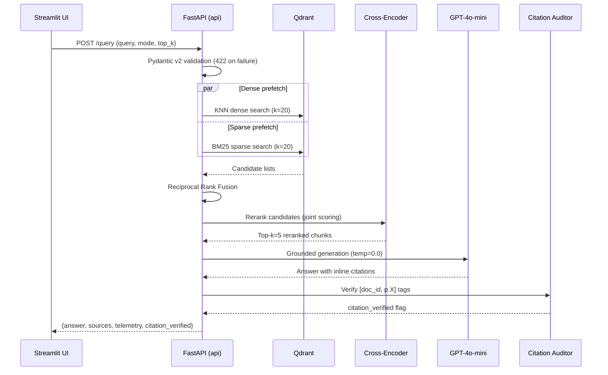

# Specification-Driven Design (SDD): ClinVerify Hybrid RAG Engine

> **Document type:** Specification-Driven Design
> **Status:** Draft for review
> **Scope:** Architectural design, interfaces, data contracts, and failure modes (no implementation code)
> **Related:** [product.md](product.md) · [architecture.md](architecture.md) · [specifications.md](specifications.md)

---

## 1. Executive Summary & Core Engineering Goals

ClinVerify is a containerized, microservice-based Retrieval-Augmented Generation (RAG) engine that extracts exact drug dosing regimens, contraindications, and clinical-trial cohort eligibility criteria from dense regulatory PDFs (FDA drug labels, Phase III protocols). The primary technical challenge is **precision under numerical and negation sensitivity**: dense embedding models collapse distinct dosages (`2.5 mg` vs `25 mg`) and serum thresholds (`CrCl < 30 mL/min`) into nearly identical vector neighborhoods, while naive character chunking fragments multi-row dosing tables. The system therefore fuses **sparse lexical BM25 retrieval** (exact tokens, numbers, negation) with **dense semantic retrieval** via Reciprocal Rank Fusion, then applies a **cross-encoder reranker** for joint query-document scoring, and finally enforces **programmatic citation verification** so that no clinical claim can be emitted without a traceable page-level source.

**Key engineering trade-offs:**

| Trade-off | Decision | Rationale |
| :--- | :--- | :--- |
| **Latency vs. accuracy** | Accept ~350 ms cross-encoder reranking overhead | Reranking resolves clinical negation and dosage collisions that dense-only retrieval misses; correctness dominates in a regulated domain. P95 target is `< 800 ms` total. |
| **Local embeddings vs. hosted APIs** | Local ONNX (FastEmbed) for embedding + reranking; hosted LLM only for generation | Eliminates per-query embedding cost, keeps PHI-adjacent text on-premise, and removes network variance from the retrieval path. |
| **Determinism vs. fluency** | `temperature=0.0` + strict grounding prompt | Reproducible, auditable answers outweigh stylistic variation. |
| **Abstention vs. coverage** | Deterministic `INSUFFICIENT_CONTEXT` refusal | An unanswered question is preferable to a hallucinated dosage. |

---

## 2. System Topology & Data Flow

### 2.1 Deployment Topology

Three containers orchestrated by Docker Compose:

- **`api`** — FastAPI + Uvicorn. Owns ingestion, retrieval, reranking, generation, and citation audit.
- **`qdrant`** — Vector database holding the hybrid `clinical_trials_hybrid` collection.
- **`ui`** — Streamlit evidence inspector; consumes the FastAPI service only (never Qdrant directly).

### 2.2 Request Lifecycle — Ingestion (`POST /ingest`)

1. Client uploads a binary PDF as `multipart/form-data` with a `doc_id` query parameter.
2. API validates MIME type, size cap, and `doc_id` format (`400`/`422` on failure).
3. `pymupdf4llm` parses the PDF into structured Markdown, preserving tables and hierarchical headers.
4. `RecursiveCharacterTextSplitter` chunks Markdown (600 tokens / 80 overlap) at table-header boundaries.
5. FastEmbed computes **dense** (`bge-small-en-v1.5`, 384-dim) and **sparse** (`Qdrant/bm25`) vectors per chunk.
6. Points are upserted into Qdrant with payload metadata (`doc_id`, `page_num`, `citation`, `text`).
7. API returns page and chunk counts.

### 2.3 Request Lifecycle — Query (`POST /query`)

1. Client submits `{query, mode, top_k}` as JSON.
2. API validates the body via Pydantic v2 (`422` on schema violation).
3. **Prefetch (parallel):** dense KNN and sparse BM25 queries execute concurrently against Qdrant (`k=20` each).
4. **RRF fusion:** ranked lists are merged into a single candidate set.
5. **Cross-encoder reranking:** `bge-reranker-base` scores query-document pairs jointly; top `k=5` retained.
6. **Grounded generation:** `gpt-4o-mini` (`temperature=0.0`) answers strictly from reranked context with inline citations.
7. **Citation audit:** regex extraction of `[doc_id, p.X]` tags; each must map to a retrieved chunk. Unverified claims are flagged.
8. API returns answer, sources (with scores), telemetry, and `citation_verified`.

### 2.4 Flow Diagram



---

## 3. API Contracts & Pydantic Data Models

### 3.1 `POST /ingest`

- **Content-Type:** `multipart/form-data`
- **Query params:** `doc_id: str` (required; `^[A-Za-z0-9_\-]{3,128}$`)

**Response `200`:**

```json
{
  "status": "success",
  "doc_id": "FDA_Apixaban_2025",
  "pages_processed": 24,
  "chunks_indexed": 185
}
```

### 3.2 `POST /query`

**Request model:**

```python
class QueryRequest(BaseModel):
    query: str = Field(..., min_length=3, max_length=2000)
    mode: Literal["hybrid_rerank", "dense_only"] = "hybrid_rerank"
    top_k: int = Field(default=5, ge=1, le=20)
```

**Response model:**

```python
class Source(BaseModel):
    text: str
    citation: str
    rerank_score: float | None
    score: float

class Telemetry(BaseModel):
    retrieval_ms: float
    rerank_ms: float
    generation_ms: float
    total_ms: float

class QueryResponse(BaseModel):
    query: str
    answer: str
    sources: list[Source]
    telemetry: Telemetry
    citation_verified: bool
```

**Example response:**

```json
{
  "query": "What is the reduced dose of Apixaban for patients with serum creatinine >= 1.5 mg/dL?",
  "answer": "For patients with serum creatinine >= 1.5 mg/dL accompanied by age >= 80 years or body weight <= 60 kg, the recommended dose of apixaban is 2.5 mg orally twice daily [FDA_Apixaban_2025, p.4].",
  "sources": [
    {
      "text": "Table 1: Dose Adjustments... In patients with any 2 of the following: age >= 80, body weight <= 60 kg, or serum creatinine >= 1.5 mg/dL, the dose is 2.5 mg BID.",
      "citation": "[FDA_Apixaban_2025, p.4]",
      "rerank_score": 4.821,
      "score": 0.892
    }
  ],
  "telemetry": {
    "retrieval_ms": 114.2,
    "rerank_ms": 342.6,
    "generation_ms": 412.1,
    "total_ms": 868.9
  },
  "citation_verified": true
}
```

### 3.3 Error Payloads

All errors follow a single envelope:

```python
class ErrorResponse(BaseModel):
    error: str            # machine-readable code
    detail: str           # human-readable message
    request_id: str       # correlation id
```

| Status | `error` | Trigger |
| :--- | :--- | :--- |
| **400** | `invalid_document` | Non-PDF MIME, corrupt/encrypted PDF, or unreadable bytes. |
| **400** | `empty_collection` | `/query` issued before any document is ingested. |
| **422** | `validation_error` | Pydantic schema violation (`top_k` out of range, `query` too short, bad `mode`). |
| **500** | `upstream_llm_error` | OpenAI API failure/timeout after retries. |
| **500** | `qdrant_unavailable` | Vector store connection failure. |
| **503** | `reranker_unavailable` | Cross-encoder model failed to load. |

---

## 4. Core Component Specifications

### 4.1 Ingestion Pipeline (`src/ingestion.py`)

- **Parser:** `pymupdf4llm` → structured Markdown preserving tables (`| ... |`) and headers (`##`, `###`).
- **Chunking:** LangChain `RecursiveCharacterTextSplitter`, `chunk_size=600` tokens, `chunk_overlap=80`; separators ordered to split at table headers (`\n## `, `\n### `, `\n\n`, `\n`, ` `) so rows stay with their section.
- **Embedding:**
  - Dense — `BAAI/bge-small-en-v1.5`, 384 dims, cosine.
  - Sparse — `Qdrant/bm25` with server-side IDF (`models.Modifier.IDF`).
- **Payload:** `doc_id`, `page_num`, `citation` (`[FDA_Apixaban_2025, p.4]`), `text`.
- **Idempotency:** deterministic point IDs (`uuid5(doc_id, chunk_index)`) make re-ingestion overwrite rather than duplicate.

### 4.2 Hybrid Retrieval (`src/retrieval.py`)

- **Prefetch:** concurrent dense KNN + sparse BM25, `k=20` each.
- **Fusion:** Reciprocal Rank Fusion — `score = Σ 1 / (k + rank)` with `k=60`.
- **Rerank:** `BAAI/bge-reranker-base` joint query-document scoring; retain top `k=5`.
- **Dense-only mode:** bypasses prefetch fusion and reranking for baseline comparison in the UI.

### 4.3 Generation & Citation Auditor (`src/generator.py`)

- **LLM:** `gpt-4o-mini`, `temperature=0.0`.
- **System constraints:** answer solely from provided context; inline citations required; emit `INSUFFICIENT_CONTEXT` when evidence is absent.
- **Auditor:** regex `\[([A-Za-z0-9_\-]+),\s*p\.(\d+)\]` extracts tags; each must resolve to a retrieved chunk's `citation`. Unresolved tags set `citation_verified=false` and are flagged.

### 4.4 Qdrant Collection

- **Name:** `clinical_trials_hybrid`
- **Dense:** `dense`, size 384, cosine.
- **Sparse:** `bm25`, `SparseVectorParams` with IDF modifier.
- **Payload:** as defined in §4.1.

---

## 5. Failure Modes & Edge-Case Mitigations

| # | Failure Mode | Impact | Mitigation |
| :--- | :--- | :--- | :--- |
| **FM-1** | **Out-of-memory chunking** on large multi-hundred-page PDFs | API OOM-killed mid-ingest; partial index | Stream parsing page-by-page; enforce upload size cap and a max-pages guard; upsert in batches with a bounded buffer; reject oversized docs with `400 invalid_document`. |
| **FM-2** | **Vector divergence / semantic collision** (`2.5 mg` ≈ `25 mg`) | Retrieval returns the wrong dosage | Hybrid BM25 prefetch captures exact tokens; RRF fuses lexical + semantic; cross-encoder rerank promotes exact numeric matches; golden-dataset regression gate catches drift. |
| **FM-3** | **Unverified LLM hallucinations** | Fabricated dosage or citation in a regulated workflow | `temperature=0.0`, strict grounding prompt, deterministic `INSUFFICIENT_CONTEXT` abstention, and regex citation audit that flags any tag not mapped to a retrieved chunk. |
| **FM-4** | **Table fragmentation** across chunk boundaries | Condition separated from its dose adjustment | Header-aware separators in the splitter; overlap of 80 tokens; table-preserving Markdown from `pymupdf4llm`. |
| **FM-5** | **Upstream LLM / Qdrant unavailability** | Query fails opaquely | Explicit `500`/`503` error envelopes with `request_id`; bounded retries with exponential backoff; retrieval still returns sources even if generation fails (degraded mode). |
| **FM-6** | **Empty or cold collection** | Query against no data returns noise | Explicit `empty_collection` `400` guard before retrieval. |

---

## 6. Verification, Telemetry & Testing Plan

### 6.1 Per-Request Telemetry

Logged as structured JSON for every request:

| Metric | Description |
| :--- | :--- |
| `request_id` | Correlation id propagated across stages and error payloads. |
| `retrieval_ms` | Dense + sparse prefetch and RRF fusion. |
| `rerank_ms` | Cross-encoder scoring. |
| `generation_ms` | LLM call. |
| `total_ms` | End-to-end latency (P95 target `< 800 ms`). |
| `mode` | `hybrid_rerank` or `dense_only`. |
| `top_k` | Requested result count. |
| `candidates_prefetch` | Candidate count entering rerank. |
| `citation_verified` | Boolean audit outcome. |
| `citation_unresolved_count` | Number of tags that failed mapping. |
| `abstained` | Whether `INSUFFICIENT_CONTEXT` was returned. |
| `error_code` | Set on non-2xx responses. |

### 6.2 Test Suite

- **Unit tests**
  - Chunking preserves table rows and respects 600/80 token bounds.
  - RRF fusion math against synthetic ranked lists.
  - Citation regex extraction and mapping (positive + unresolved cases).
  - Pydantic validation: boundary `top_k`, short `query`, bad `mode`, invalid `doc_id`.
- **Integration tests**
  - `POST /ingest` → `POST /query` round-trip against a live Qdrant container.
  - Citation audit end-to-end: injected hallucinated citation must set `citation_verified=false`.
  - Failure-path assertions for `400`/`422`/`500`/`503` envelopes.
- **Evaluation gate (`tests/test_ragas_eval.py`)**
  - Framework: PyTest + Ragas v0.4+.
  - Metrics: `Faithfulness ≥ 0.95`, `LLMContextPrecisionWithReference ≥ 0.88`.
  - Dataset: `golden_dataset.json` (curated pharmacological Q&A with `expected_doc_id` and `expected_page`).
  - Runs on every pull request via GitHub Actions; **blocks merge on threshold regression**.

### 6.3 Golden Dataset Schema

```json
[
  {
    "id": "q_001",
    "question": "What is the reduced dose of Apixaban for patients with serum creatinine >= 1.5 mg/dL?",
    "ground_truth": "Patients meeting at least two criteria including serum creatinine >= 1.5 mg/dL receive 2.5 mg twice daily.",
    "expected_doc_id": "FDA_Apixaban_2025",
    "expected_page": 4
  }
]
```
